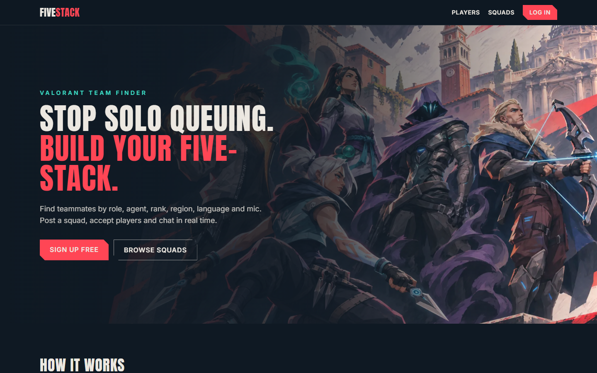
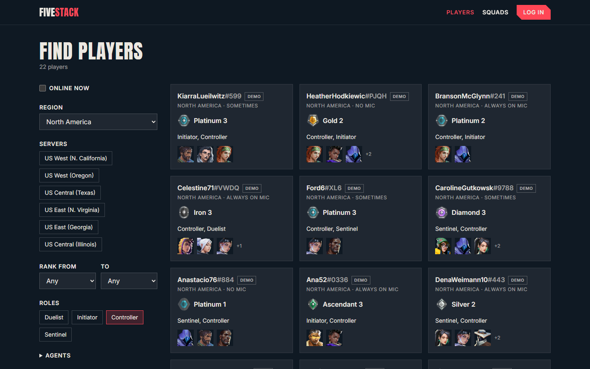
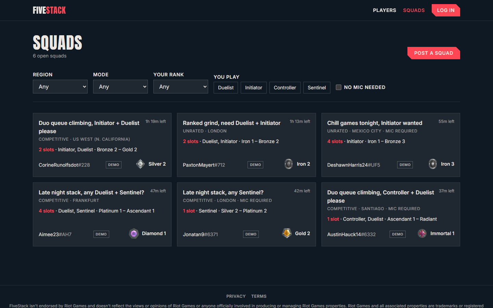
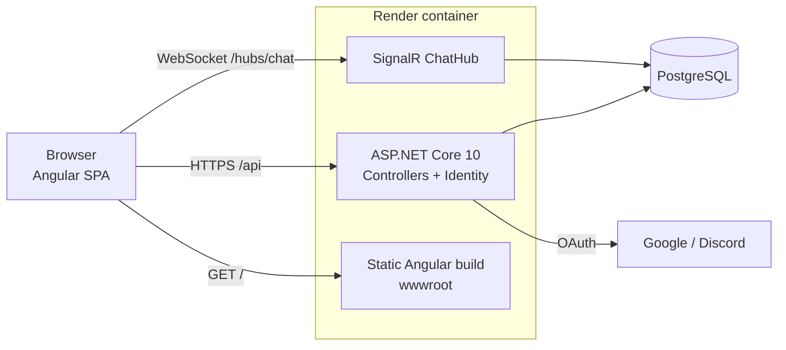

# FiveStack: Valorant Team Finder

> Find teammates by **role, agent, rank, region, server, language and mic**, then chat in real time and build your five-stack.


**Live demo:** [fivestack-nn1w.onrender.com](https://fivestack-nn1w.onrender.com) · **API docs:** `/scalar` on the live site




| Player finder | Squads board |
|---|---|
|  |  |

## Features

- **Sign up your way:** email + password, or one click with **Google** or **Discord**.
- **Rich player profiles:** Riot ID, region & preferred servers, platform (PC / PlayStation / Xbox), current & peak rank, roles, agent pool, languages, mic, game modes, playstyle, play times.
- **Player finder:** filter by any profile field, including *"plays Omen or Viper"* and *"Controller main, Plat to Diamond, EU Frankfurt, has mic"*. Filters live in the URL, so searches are shareable.
- **Squads board:** post an LFG listing ("2/5, need Controller + Sentinel"). Players request to join, and the host accepts them into the squad chat. Posts expire automatically.
- **Real-time chat:** direct messages and squad group chats over SignalR (WebSockets), with unread counts, online presence, and blocking.
- **Linked accounts:** optionally show your verified **Discord** on your profile. A **tracker.gg** link is built from your Riot ID.

## Tech stack

| Layer | Tech |
|---|---|
| Frontend | Angular 22 (standalone components, signals), TypeScript, Tailwind CSS 4, `@microsoft/signalr` |
| Backend | ASP.NET Core 10 Web API (C#), ASP.NET Core Identity, SignalR, built-in rate limiting |
| Data | PostgreSQL 17 via EF Core 10 + Npgsql, with array columns and GIN indexes for agent/role filters |
| Auth | Cookie auth (same origin), Google + Discord OAuth |
| Tests | xUnit + WebApplicationFactory + Testcontainers (real Postgres), Vitest (Angular) |
| Infra | Docker (single image), Render (app), Neon (Postgres), GitHub Actions CI/CD |



See [docs/ARCHITECTURE.md](docs/ARCHITECTURE.md) for the data model, auth flow and design decisions.

## Run locally

Prerequisites: Node 24+, .NET 10 SDK, Docker.

```bash
# 1. Database
docker compose up -d

# 2. API (http://localhost:5000; API docs at /scalar)
cd server/FiveStack.Api
dotnet run

# 3. Client (http://localhost:4200; proxies /api and /hubs to the API)
cd client
npm install
npm start
```

OAuth (optional in dev): see [docs/DEPLOYMENT.md](docs/DEPLOYMENT.md#oauth-apps) and set secrets with `dotnet user-secrets`.

## Tests

```bash
cd server && dotnet test          # integration tests spin up Postgres with Testcontainers
cd client && npm test -- --watch=false
```

## Project docs

- [Architecture](docs/ARCHITECTURE.md)
- [Roadmap](docs/ROADMAP.md)
- [Deployment](docs/DEPLOYMENT.md)
- [Contributing](CONTRIBUTING.md)

## Legal

FiveStack isn't endorsed by Riot Games and doesn't reflect the views or opinions of Riot Games or anyone officially involved in producing or managing Riot Games properties. Riot Games and all associated properties are trademarks or registered trademarks of Riot Games, Inc.

FiveStack was created under Riot Games' "Legal Jibber Jabber" policy using assets owned by Riot Games. Riot Games does not endorse or sponsor this project.

Agent and rank icons come from [valorant-api.com](https://valorant-api.com) under Riot's fan-content policy. Landing artwork is AI-generated fan art of Valorant agents and maps. It contains no Riot logos.

Licensed under [MIT](LICENSE).
