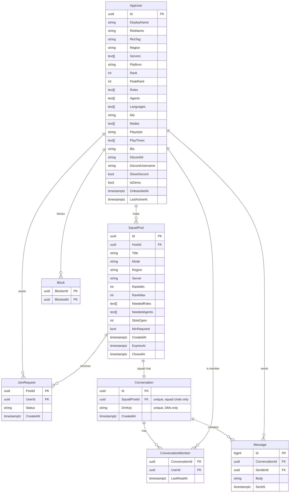
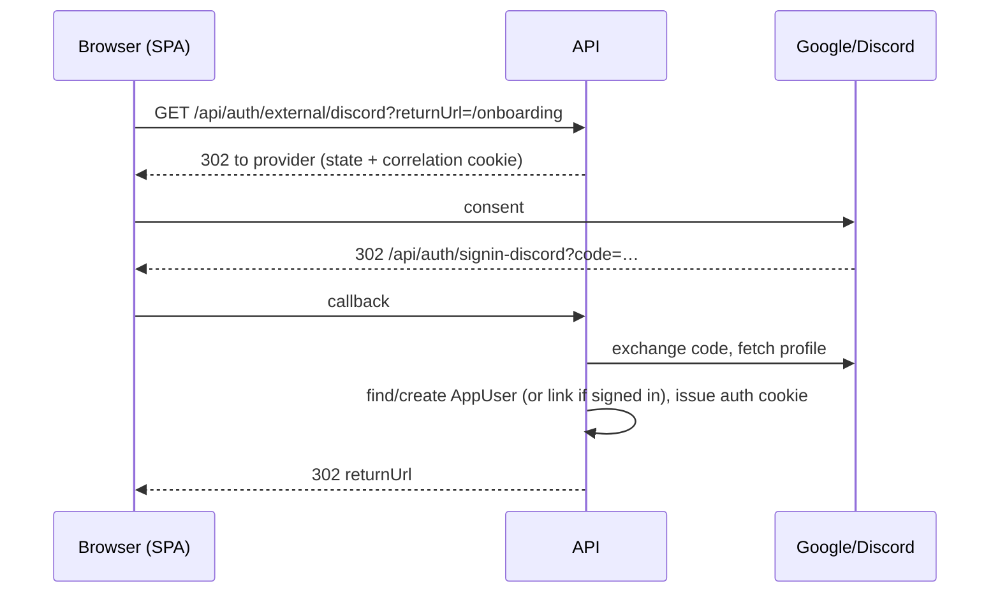

# Architecture

## Overview

FiveStack ships as **one Docker container**: an ASP.NET Core 10 app that serves

1. the JSON API under `/api`,
2. the SignalR hub at `/hubs/chat`,
3. the compiled Angular SPA from `wwwroot`, with every other route falling back to `index.html`.

PostgreSQL (Neon in production, Docker locally) is the only stateful dependency.

### Why one container (same origin)?

- **Cookie auth just works.** `*.vercel.app` and `*.onrender.com` are separate sites on the public suffix list. A split deploy needs cross-site cookies (blocked by modern browsers) or JWT + refresh-token plumbing. With same-origin hosting, the app uses an `HttpOnly; Secure; SameSite=Lax` cookie issued by ASP.NET Core Identity.
- **No CORS**, and SignalR WebSockets connect without a proxy.
- **One deploy, one Dockerfile, one free instance.**

The tradeoff: the SPA is not on a CDN edge. Acceptable for this scale.

## Backend layout

```
server/FiveStack.Api/
  Auth/       external login (Google/Discord), account linking, logout
  Profiles/   GET/PUT /api/me/profile, public profile, account deletion
  Players/    search endpoint with filters
  Squads/     LFG posts + join requests
  Chat/       ChatHub (SignalR), conversations, messages, blocks, presence
  Meta/       GameData.cs (regions, servers, ranks, roles, modes, languages) + agents.json
  Data/       AppDbContext, EF migrations, demo seed (Bogus)
```

Folders are organized by feature, not by layer, so each feature's controller, DTOs and logic sit together. The project has no repository or service interfaces for single implementations; controllers use `AppDbContext` directly.

## Data model



### Why Postgres arrays instead of join tables?

Roles, agents, languages and servers are small sets of known values. Storing them as `text[]` with **GIN indexes** means:

- "plays any of these agents" is one indexed predicate: `agents && ARRAY['omen','viper']`. EF Core expresses it as `u.Agents.Any(a => filter.Contains(a))`.
- No join tables, no N+1 queries, and the profile save is a single row update.

Valid values come from `Meta/` (one source of truth) and are checked on write. Single-value fields (region, platform, mic, playstyle) are plain strings holding meta ids rather than C# enums, so the values are defined in exactly one place. `Rank` and `PeakRank` are the valorant-api competitive tier number (0 = Unranked, 3 = Iron 1 … 27 = Radiant), which makes rank-range filters a simple `BETWEEN` and maps directly to the tier icon URL.

### Squads

A post is **open** while `ClosedAt` is null, `ExpiresAt` (created + 3h) is in the future, and `SlotsOpen > 0`. Expiry is checked at query time, so no background job is needed. A host can have one open post at a time. `JoinRequest.Status` is `pending`, `accepted` or `declined`. Accepting runs two conditional updates in one transaction: pending → accepted, then `SlotsOpen - 1` where the post is still open. Concurrent accepts therefore can't oversell slots.

## Authentication

- **Email/password**: ASP.NET Core Identity's `MapIdentityApi` endpoints in cookie mode.
- **Google / Discord**: standard OAuth handlers. Callback paths live under `/api/auth/signin-*`, so the Angular dev proxy forwards them.
- **Account linking**: a signed-in user who starts the Discord flow gets the login linked (`UserLoginInfo`), and `DiscordId`/`DiscordUsername` are stored for the profile's "Copy Discord" button.
- **Data Protection keys** are stored in Postgres (`PersistKeysToDbContext`), so cookies survive container restarts and redeploys.



## Real-time chat (SignalR)

- A conversation is a **DM** (`DmKey` = both user ids, smaller first, unique so a pair has one DM) or a **squad chat** (`SquadPostId`). A squad chat is created with its post and starts with the host. Accepting a join request adds the player in the same transaction that takes the slot.
- **Messages are sent over REST** (`POST /api/conversations/{id}/messages`): membership check, block check (DMs), the `messages` rate limit, persist, then push. One code path for validation and limits, and the integration tests need only HttpClient.
- `ChatHub` at `/hubs/chat` is **push-only**. It requires `[Authorize]` and uses the same auth cookie. The server pushes to users, not groups: `Clients.Users(memberIds)`, keyed by the `NameIdentifier` claim. A conversation has at most 5 members and the send already loads them, so there is no group membership to keep in sync.
  - `MessageReceived(message)` goes to every member, the sender included, so the sender's other tabs update too.
  - `SquadChanged(postId)` goes to the host on a new or cancelled join request and to the player when the host answers. It replaces the squad page's 15s poll.
- Unread count = messages from others newer than `ConversationMember.LastReadAt`. Opening a thread, and sending into it, moves `LastReadAt`.
- Blocks are one row per blocker and work both ways for DMs: neither player can start or send a DM. Squad chats ignore blocks.
- Presence: an in-memory map of userId to hub connection count. A player is "online now" while connected, **or** for 5 minutes after an authenticated API call (`LastActiveAt`, stamped at most once a minute by middleware). `LastActiveAt` also drives the player finder's "recently active" sort. The in-memory map works only with a single instance. Scaling out requires a Redis backplane and Redis-backed presence.
- The client lazy-loads `@microsoft/signalr` on sign-in, so signed-out visitors don't download it.

## Security checklist

- Membership is checked on every conversation read, send and mark-read; a non-member gets the same 404 as a missing conversation. Blocks are enforced on DM creation and send.
- Rate limiting (`AddRateLimiter`) applies to auth, squad creation, message send (30/min per user) and starting a DM (30/hour per user).
- Input lengths are capped with DataAnnotations. Angular escapes all bound text.
- `SameSite=Lax` cookie + JSON-only request bodies mitigate CSRF.
- `UseForwardedHeaders` is enabled so OAuth redirect URIs use `https` behind Render's proxy.
- Secrets come only from env vars or `dotnet user-secrets`.

## Frontend

```
client/src/app/
  core/       AuthService, MetaService, ChatService (signals), guards, HTTP setup
  shared/     rank badge, agent icon grid, filter chips, angled button
  features/   landing, auth, onboarding, players, squads, chat, settings, legal
```

- Standalone components, signals for state, lazy-loaded feature routes.
- Search filters are serialized to URL query params, so a search is shareable and back/forward works.
