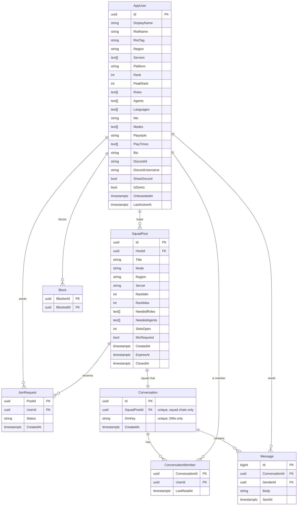
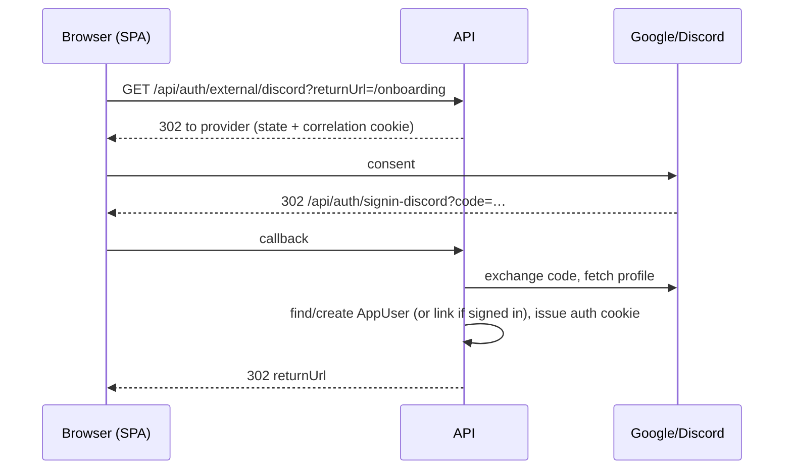

# Architecture

## Overview

FiveStack ships as **one Docker container**: an ASP.NET Core 10 app that serves

1. the JSON API under `/api`,
2. the SignalR hub at `/hubs/chat`,
3. the compiled Angular SPA from `wwwroot`, with every other route falling back to `index.html`.

PostgreSQL (Neon in production, Docker locally) is the only stateful dependency.

### Why one container (same origin)?

- **Cookie auth just works.** `*.vercel.app` and `*.onrender.com` are separate sites on the public suffix list. A split deploy needs cross-site cookies (blocked by modern browsers) or JWT + refresh-token plumbing. With same-origin hosting, the app uses an `HttpOnly; Secure; SameSite=Lax` cookie issued by ASP.NET Core Identity.
- **No CORS**, and SignalR WebSockets connect without a proxy.
- **One deploy, one Dockerfile, one free instance.**

The tradeoff: the SPA is not on a CDN edge. Acceptable for this scale.

## Backend layout

```
server/FiveStack.Api/
  Auth/       external login (Google/Discord), account linking, logout
  Profiles/   GET/PUT /api/me/profile, public profile, account deletion
  Players/    search endpoint with filters
  Squads/     LFG posts + join requests
  Chat/       ChatHub (SignalR), conversations, messages, blocks, presence
  Meta/       GameData.cs (regions, servers, ranks, roles, modes, languages) + agents.json
  Data/       AppDbContext, EF migrations, demo seed (Bogus)
```

Folders are organized by feature, not by layer, so each feature's controller, DTOs and logic sit together. The project has no repository or service interfaces for single implementations; controllers use `AppDbContext` directly.

## Data model



### Why Postgres arrays instead of join tables?

Roles, agents, languages and servers are small sets of known values. Storing them as `text[]` with **GIN indexes** means:

- "plays any of these agents" is one indexed predicate: `agents && ARRAY['omen','viper']`. EF Core expresses it as `u.Agents.Any(a => filter.Contains(a))`.
- No join tables, no N+1 queries, and the profile save is a single row update.

Valid values come from `Meta/` (one source of truth) and are checked on write. Single-value fields (region, platform, mic, playstyle) are plain strings holding meta ids rather than C# enums, so the values are defined in exactly one place. `Rank` and `PeakRank` are the valorant-api competitive tier number (0 = Unranked, 3 = Iron 1 … 27 = Radiant), which makes rank-range filters a simple `BETWEEN` and maps directly to the tier icon URL.

### Squads

A post is **open** while `ClosedAt` is null, `ExpiresAt` (created + 3h) is in the future, and `SlotsOpen > 0`. Expiry is checked at query time, so no background job is needed. A host can have one open post at a time. `JoinRequest.Status` is `pending`, `accepted` or `declined`. Accepting runs two conditional updates in one transaction: pending → accepted, then `SlotsOpen - 1` where the post is still open. Concurrent accepts therefore can't oversell slots.

### Demo data

With config `Demo:Seed` on (Development, and the live demo via `Demo__Seed=true`), startup runs `Data/DemoSeed.cs`: 150 demo players from a fixed Bogus seed, every value picked from `Meta/`, inserted once (`IsDemo = true`, no password, so nobody can log in as one). The squads board tops up demo posts to 6 on each load, deleting expired ones, because posts expire after 3h and no background job exists. The API answers 409 to DMs and join requests aimed at demo players, and the UI shows a "Demo" chip and hides Message / Ask to join for them. Tests turn the flag off and seed explicitly in their own container.

## Authentication

- **Email/password**: ASP.NET Core Identity's `MapIdentityApi` endpoints in cookie mode. Password sign-in needs a confirmed email (`RequireConfirmedAccount`). Sign-up emails a link to the SPA's `/confirm-email` page, and "forgot password" emails a link to `/reset-password`. `Auth/EmailSender.cs` sends both through Resend's HTTP API. Login answers 401 with `detail: "NotAllowed"` until the email is confirmed, and the SPA then offers to resend the link.
- **Email links ignore the request's Host header.** They're built from `App:PublicUrl`. MapIdentityApi builds its confirmation link from the request host, so a register call with `Host: evil.example` would otherwise email the victim a working code on the attacker's site (a test covers this). MapIdentityApi also HTML-encodes the link and code before handing them over, so the sender decodes them first.
- **Who counts as confirmed** (`ConfirmedEmailOrExternalLogin`): a confirmed email, or any Google/Discord login, because the provider vouches for the account. A provider's email is stored only when the provider marks it verified (Google `email_verified`, Discord `verified`). An unverified one could be someone else's address, and that person could later take the account over with a password reset.
- **Startup checks:** outside Development, the app refuses to start without `App:PublicUrl`, or without a Resend key while confirmation is on. A misconfigured deploy then fails Render's health check and the old version keeps serving.
- **Google / Discord**: standard OAuth handlers. Callback paths live under `/api/auth/signin-*`, so the Angular dev proxy forwards them.
- **Account linking**: a signed-in user who starts the Discord flow gets the login linked (`UserLoginInfo`), and `DiscordId`/`DiscordUsername` are stored for the profile's "Copy Discord" button.
- **Data Protection keys** are stored in Postgres (`PersistKeysToDbContext`), so cookies survive container restarts and redeploys.



## Real-time chat (SignalR)

- A conversation is a **DM** (`DmKey` = both user ids, smaller first, unique so a pair has one DM) or a **squad chat** (`SquadPostId`). A squad chat is created with its post and starts with the host. Accepting a join request adds the player in the same transaction that takes the slot.
- **Messages are sent over REST** (`POST /api/conversations/{id}/messages`): membership check, block check (DMs), the `messages` rate limit, persist, then push. One code path for validation and limits, and the integration tests need only HttpClient.
- `ChatHub` at `/hubs/chat` is **push-only**. It requires `[Authorize]` and uses the same auth cookie. The server pushes to users, not groups: `Clients.Users(memberIds)`, keyed by the `NameIdentifier` claim. A conversation has at most 5 members and the send already loads them, so there is no group membership to keep in sync.
  - `MessageReceived(message)` goes to every member, the sender included, so the sender's other tabs update too.
  - `SquadChanged(postId)` goes to the host on a new or cancelled join request and to the player when the host answers. It replaces the squad page's 15s poll.
- Unread count = messages from others newer than `ConversationMember.LastReadAt`. Opening a thread, and sending into it, moves `LastReadAt`.
- Blocks are one row per blocker and work both ways for DMs: neither player can start or send a DM. Squad chats ignore blocks.
- Presence: an in-memory map of userId to hub connection count. A player is "online now" while connected, **or** for 5 minutes after an authenticated API call (`LastActiveAt`, stamped at most once a minute by middleware). `LastActiveAt` also drives the player finder's "recently active" sort. The in-memory map works only with a single instance. Scaling out requires a Redis backplane and Redis-backed presence.
- The client lazy-loads `@microsoft/signalr` on sign-in, so signed-out visitors don't download it.

## Observability

OpenTelemetry exports traces, metrics and logs over OTLP. Production sends them to Grafana Cloud (Tempo, Prometheus, Loki). Locally, `docker compose --profile otel` runs the same stack (`grafana/otel-lgtm`). The SDK is only registered when `OTEL_EXPORTER_OTLP_ENDPOINT` is set, so dev and tests run without it.

- **Traces:** every API request (ASP.NET Core), with child spans for each SQL command (Npgsql) and outgoing HTTP call (OAuth, email). `/api/health` pings are filtered out.
- **Metrics:** request rate and latency per route, Kestrel/SignalR connections, rate-limiter decisions, Identity sign-ins, DB pool and query time, GC/CPU/thread pool. Product metrics come from `AppMetrics.cs` (meter `FiveStack`): `fivestack.messages.sent` (tag `kind`), `fivestack.squads.created`, `fivestack.squads.join_requests`, and the `fivestack.users.online` gauge, read from `Presence`.
- **Logs:** JSON console logs in production, with the trace and span ids in scopes, so a Render log line leads to its trace. One line per API request (method, path, status, duration) via `AddHttpLogging`. SQL text stays out of the logs at Warning, because the trace spans already carry it.
- **Privacy:** client IP addresses aren't recorded, which is the semantic-convention default. Telemetry has no emails or message bodies.
- **Dashboard:** `docs/observability/grafana-dashboard.json` (players online, request rate, p95 per route, 5xx share, rate-limited requests, DB p95, product activity, connections, memory). It uses a datasource variable, so it imports into any Grafana.

## Security checklist

- Membership is checked on every conversation read, send and mark-read; a non-member gets the same 404 as a missing conversation. Blocks are enforced on DM creation and send.
- Rate limiting (`AddRateLimiter`): every `/api` call is capped per IP (300/min). On top of that, the sign-in flows (Identity endpoints, external login) get 20/min per IP, squad creation 10/hour per user, message send 30/min per user and starting a DM 30/hour per user. `/api/auth/me` and `/providers` aren't in the sign-in limit, because the SPA calls them on every page load. A 429 carries `Retry-After`.
- Public profiles never include the email or `DisplayName`, which is the real name from a Google account. Discord shows only when the player opts in.
- Errors are RFC 9457 problem details (`AddProblemDetails`, `UseExceptionHandler`, `UseStatusCodePages`) with a `traceId` that matches the OpenTelemetry trace. Production never returns stack traces.
- Security headers on every response: a strict CSP (`default-src 'self'`, so no inline or third-party scripts; images also from `media.valorant-api.com`; `frame-ancestors 'none'`), `X-Content-Type-Options`, `X-Frame-Options`, `Referrer-Policy`, `Permissions-Policy`, plus HSTS outside Development. Styles allow `'unsafe-inline'` because Angular injects component `<style>` tags. `/scalar` is exempt (its page runs an inline script). Critical-CSS inlining is off in `angular.json` because its loader is an inline script the CSP would block.
- Email confirmation for password accounts. Email links are built from config, not the Host header. Provider emails are trusted only when verified. "Forgot password" answers the same for unknown addresses. Identity locks an account for 5 minutes after 5 failed logins.
- The container runs as the image's non-root `app` user.
- Input lengths are capped with DataAnnotations. Angular escapes all bound text.
- `SameSite=Lax` cookie + JSON-only request bodies mitigate CSRF.
- `UseForwardedHeaders` is enabled so OAuth redirect URIs use `https` behind Render's proxy.
- Secrets come only from env vars or `dotnet user-secrets`.

## Testing

| Layer | Tool | What it covers |
|---|---|---|
| Unit | Vitest (Angular) | guards, forms, components |
| Integration | xUnit + `WebApplicationFactory` + Testcontainers | the real API against a throwaway Postgres 17: auth, validation against meta, filters, squad slot races, chat membership/blocks, security headers, rate-limit scope |
| End to end | Playwright (Chromium) | the production Docker image under its real CSP: player filters, posting and closing a squad, and a DM that arrives live over the WebSocket |

Integration tests share one container per run. Each test makes its own users (unique emails) and filters to its own region, so tests don't step on each other. E2E specs register users through the API, which shares the browser context's cookies, so each spec drives only the UI under test.

## Frontend

```
client/src/app/
  core/       AuthService, MetaService, ChatService (signals), guards, HTTP setup
  shared/     rank badge, agent icon grid, filter chips, angled button
  features/   landing, auth, onboarding, players, squads, chat, settings, legal
```

- Standalone components, signals for state, lazy-loaded feature routes.
- Search filters are serialized to URL query params, so a search is shareable and back/forward works.
- Landing art (Valorant fan art generated with Higgsfield, using official agent portraits and map splashes from valorant-api.com as references) lives in `client/public/assets/` as WebP: `hero/hero.webp` + `hero-960.webp`, `hero/og.jpg` (1200×630 crop for link previews) and `roles/{roleId}.webp`, keyed by the meta role id. The hero's slow pan/zoom is a CSS animation (`animate-hero-pan` in `styles.css`) behind `motion-safe:`, so reduced-motion users get the still.
- Fonts (Anton, Inter; OFL, from Fontsource) are self-hosted in `client/public/fonts/` with `unicode-range` subsets. The CSP can then stay `font-src 'self'`, and no visitor IP goes to Google Fonts.
- Below `md`, the header nav collapses into a native `<details>` menu. A skip link jumps to `<main>`.
